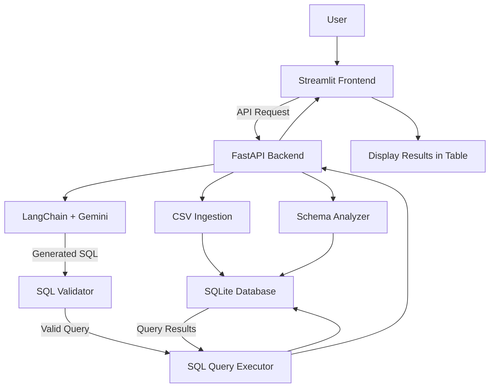

# System Architecture — AI BI Assistant

## 1. Architecture Overview

The AI BI Assistant allows users to upload CSV files and ask questions about their data.

The frontend is built using Streamlit, and the backend is built using FastAPI. Google Gemini is used to generate SQL queries from user questions. SQLite stores the uploaded data and executes the queries.

## 2. Architecture Diagram

## 3. Main Components

### Streamlit Frontend

- Provides the user interface.
- Allows users to upload CSV files.
- Allows users to enter business questions.
- Displays query results in tables.
- Allows users to view the generated SQL query.

### FastAPI Backend

- Handles API requests from Streamlit.
- Processes uploaded CSV files.
- Gets dataset information.
- Sends questions to the SQL generation component.
- Checks and executes generated SQL queries.
- Returns results to the frontend.

### CSV Ingestion

- Reads CSV files using Pandas.
- Checks the uploaded data.
- Stores the data in SQLite.

### Schema Analyzer

- Gets the column names and data types from the dataset.
- Provides dataset information to Gemini for SQL generation.

### LangChain and Google Gemini

- Understands business questions written in natural language.
- Uses the dataset column details to understand the data.
- Generates SQL queries based on the user's question.

### SQL Validator

- Checks the generated SQL query.
- Allows SELECT and WITH queries.
- Blocks operations such as INSERT, UPDATE, DELETE, and DROP.
- Rejects multiple SQL statements.

### SQL Query Executor

- Executes valid SQL queries.
- Uses a read-only database connection.
- Returns the query results as a Pandas DataFrame.

### SQLite Database

- Stores the uploaded dataset.
- Supports SQL queries for data analysis.
- Provides data for analytical queries.

## 4. Application Workflow

1. The user uploads a CSV file through Streamlit.
2. Streamlit sends the file to the FastAPI `/upload` endpoint.
3. FastAPI reads the CSV file and stores the data in SQLite.
4. The user enters a business question.
5. Streamlit sends the question to the FastAPI `/ask` endpoint.
6. FastAPI gets the dataset column details.
7. LangChain sends the question and dataset details to Gemini.
8. Gemini generates an SQL query.
9. The SQL validator checks the generated query.
10. The query executor runs the valid query against SQLite.
11. FastAPI sends the results back to Streamlit.
12. Streamlit displays the results in a table.

## 5. API Endpoints

| Method | Endpoint | Purpose |
|---|---|---|
| GET | `/` | Displays the backend welcome message |
| POST | `/upload` | Uploads and stores a CSV file |
| GET | `/schema` | Gets the uploaded dataset details |
| POST | `/ask` | Generates and executes an SQL query |

## 6. Design Decisions

- **Modular structure:** Different parts of the application are kept in separate modules to make the code easier to understand and maintain.
- **Frontend and backend separation:** Streamlit communicates with FastAPI through APIs. It does not directly access the database.
- **Gemini for SQL generation:** Users can ask different questions about their uploaded data without needing predefined questions.
- **SQL validation:** Generated queries are checked before execution.
- **Read-only query execution:** Analytical queries use a read-only database connection.
- **SQLite:** SQLite is used to store uploaded data because it is simple and suitable for this project.